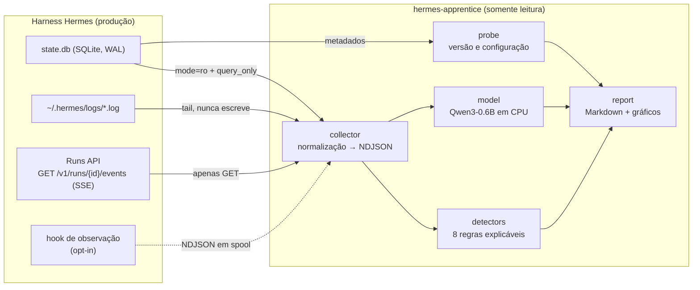

# hermes-apprentice

**Aprendiz de observação para o harness [Hermes Agent](https://github.com/NousResearch/hermes-agent).**
Coleta eventos de sessões em **modo somente observação**, detecta padrões e loops com regras
explicáveis, mede o desempenho de um modelo local pequeno (Qwen3‑0.6B) sobre o mesmo problema e
publica o resultado como relatório reproduzível.

[](LICENSE)
[](pyproject.toml)
[](docs/etica-e-limites.md)
[](reports/relatorio-001-padroes-e-loops.md)

---

## O que este projeto faz

O Hermes é um harness de agente autônomo: ele executa ferramentas, persiste sessões em
`~/.hermes/state.db`, expõe um stream estruturado de eventos e registra logs. Quando um agente
"trava", o sintoma raramente aparece como um erro: ele **repete** ações, alterna ferramentas sem
convergir, gasta o orçamento de iterações ou morre por contenção de escrita no banco.

O `hermes-apprentice` olha para esse fluxo de fora, sem interferir:

1. **Sonda** a versão e a configuração do Hermes instalado (somente leitura).
2. **Coleta** eventos de quatro fontes, normalizando tudo em um único esquema NDJSON.
3. **Detecta** oito regras de loop e de falha, com evidência rastreável por evento.
4. **Avalia** se um modelo local de 0,6 B consegue fazer o mesmo julgamento — e diz honestamente
   quando não consegue.
5. **Relata** os achados em Markdown com gráficos, a partir de artefatos JSON reproduzíveis.

## Estado das tarefas

| Tarefa | Estado | Evidência |
| --- | --- | --- |
| Identificar versão e configuração atual do Hermes | ✅ concluída | [`artifacts/hermes-environment.json`](artifacts/hermes-environment.json) — Hermes Agent **v0.19.0 (2026.7.20)**, pacote PyPI `0.19.0` × release GitHub `v0.21.6` |
| Criar repositório independente `hermes-apprentice` | ✅ concluída | este repositório (MIT, sem dependência de outros projetos) |
| Construir coletor de eventos em modo somente observação | ✅ concluída | [`src/hermes_apprentice/collector/`](src/hermes_apprentice/collector) + prova de escrita recusada em [`docs/etica-e-limites.md`](docs/etica-e-limites.md) |
| Preparar cinco cenários reproduzíveis de falha e correção | ✅ concluída | [`scenarios/`](scenarios) + [`scenarios/manifest.json`](scenarios/manifest.json) |
| Executar Qwen3‑0.6B e verificar o desempenho inicial | ✅ concluída | [`artifacts/benchmark-qwen3-0.6b.json`](artifacts/benchmark-qwen3-0.6b.json) |
| Gerar primeiro relatório de padrões e loops detectados | ✅ concluída | [`reports/relatorio-001-padroes-e-loops.md`](reports/relatorio-001-padroes-e-loops.md) |

## Como funciona



### Fontes de eventos

| Fonte | Transporte | Papel | Garantia |
| --- | --- | --- | --- |
| `runs_api` | SSE `GET /v1/runs/{id}/events` | contrato publicado; caminho preferido para execuções ao vivo | apenas `GET` |
| `spool` | NDJSON escrito por hook de observação | cobre `pre_tool_call`, `post_tool_call`, `api_request_error`… | opt-in explícito; o hook não devolve diretiva nenhuma |
| `state_db` | SQLite `file:…?mode=ro` + `PRAGMA query_only` | fonte da verdade depois do fato | escrita levanta `OperationalError` |
| `logs` | tail de `~/.hermes/logs/*.log` | cobre o que não chega às outras fontes | querystring read-only, nenhum offset persistido |
| `fixture` | NDJSON normalizado | cenários e testes | arquivo comum |

### Regras de detecção

| Regra | Categoria | O que captura |
| --- | --- | --- |
| `loop.repetition` | loop | mesma ferramenta **e** mesmos argumentos, repetidas vezes |
| `loop.no_progress` | loop | argumentos variam, resultado é sempre o mesmo (sinal de *stub* de deduplicação) |
| `loop.cycle` | loop | alternância periódica de ferramentas (A→B→A→B) com argumentos sempre diferentes |
| `loop.oscillation` | loop | mesma ferramenta alternando dois resultados: correção desfeita |
| `failure.budget_exhausted` | falha | turno encerrado por `max_iterations_reached` |
| `failure.persistence_locked` | falha | `session_persistence_failed:locked` por contenção no WAL |
| `failure.retry_storm` | falha | rajada de `api_request_error` 429/503 sem failover |
| `failure.run_not_completed` | falha | execução termina sem resposta final |

Cada achado carrega os **índices dos eventos** que o sustentam, o limiar violado e a severidade.
Os limiares ficam em `DetectorConfig` e são ajustáveis sem tocar no código.

## Cinco cenários reproduzíveis

Gerados por [`scripts/make_scenarios.py`](scripts/make_scenarios.py). Cada cenário tem três fases —
**saudável → falha/loop → correção** — e o rótulo de cada fase é conferido pelos próprios
detectores durante a validação.

| Cenário | Modo de falha do harness | Regras esperadas | Correção |
| --- | --- | --- | --- |
| `s1_loop_read_file_dedup` | releitura do mesmo arquivo; o harness devolve *stub* de deduplicação | `loop.repetition`, `loop.no_progress` | `steer` proibindo a releitura e sugerindo `offset` |
| `s2_budget_exhausted` | comando repetido com resultado invariável até `max_iterations_reached(60/60)` | `loop.no_progress`, `failure.budget_exhausted` | `steer` + leitura da mensagem de erro completa |
| `s3_state_db_lock` | `session_persistence_failed:locked` — gateway, CLI e subagente disputam o WAL | `failure.persistence_locked`, `failure.retry_storm` | interrupção + `hermes_state_lockowners` |
| `s4_provider_retry_storm` | erros 429/503 em rajada, sem backoff eficaz nem failover | `failure.retry_storm`, `failure.run_not_completed` | `steer` + failover de provedor |
| `s5_tool_cycle` | `web_search` → `web_extract` nove vezes sem convergir | `loop.cycle` | `steer` + âncora no estado local já lido |

As referências de cada modo de falha (issues e documentação oficial do harness) estão no campo
`reference` de cada `scenario.json`. Detalhes em [`docs/cenarios.md`](docs/cenarios.md).

## Instalação

```bash
git clone https://github.com/healthcare-tec/hermes-apprentice.git
cd hermes-apprentice
pip install -e ".[report]"        # sonda, coletor, detectores e relatório
pip install -e ".[report,model]"  # + bancada com Qwen3-0.6B (torch + transformers)
```

O núcleo (sonda, coletor, detectores) **não tem dependência externa** — só a biblioteca padrão.

## Uso

```bash
# 1. Versão e configuração do Hermes instalado (somente leitura)
python -m hermes_apprentice probe --hermes-home ~/.hermes

# 2. Coletar eventos de uma instalação real
python -m hermes_apprentice collect --source all --hermes-home ~/.hermes \
    --out artifacts/eventos.ndjson

# 3. Detectar padrões e loops nos cenários (ou em qualquer arquivo NDJSON)
python -m hermes_apprentice detect --input scenarios --out artifacts/deteccao.json

# 4. Bancada do modelo local
python -m hermes_apprentice bench --scenarios scenarios \
    --model Qwen/Qwen3-0.6B --out artifacts/benchmark-qwen3-0.6b.json

# 5. Relatório
python -m hermes_apprentice report --out reports/relatorio-001-padroes-e-loops.md

# Tudo de uma vez (é o caminho que produz este repositório)
python -m hermes_apprentice all
```

### Observar uma execução ao vivo pela Runs API

```bash
python -m hermes_apprentice collect --source runs_api \
    --base-url http://127.0.0.1:8080 --run-id run_abc123 --out artifacts/run_abc123.ndjson
```

### Sem Hermes instalado? Use o fixture autêntico

O diretório [`examples/hermes-home-fixture/`](examples/hermes-home-fixture) foi gerado **pelo próprio
Hermes** (via `hermes_state.SessionDB`, a API oficial), então tem o esquema real — não um esquema
que nós inventamos. Para reproduzir em outra máquina:

```bash
python scripts/make_hermes_fixture.py \
    --hermes-bin ~/hermes-lab/venv/bin/hermes \
    --hermes-python ~/hermes-lab/venv/bin/python \
    --out examples/hermes-home-fixture --force

python -m hermes_apprentice collect --source state_db \
    --hermes-home examples/hermes-home-fixture --out artifacts/eventos-fixture.ndjson
```

Saída verificada nesta máquina (Hermes v0.19.0):

```
[collect] 17 eventos gravados em artifacts/eventos-fixture.ndjson
[collect] resumo: {"by_type": {"assistant_message": 5, "tool_call_start": 4, "tool_result": 4,
                               "turn_start": 2, "session_start": 1, "session_end": 1},
                   "tools": {"read_file": 6, "edit_file": 2}}
```

## Garantias de somente observação

| Garantia | Como é imposta | Como é verificada |
| --- | --- | --- |
| Nunca escreve em `state.db` | URI `mode=ro` **e** `PRAGMA query_only = ON` | `assert_readonly()` prova que um `CREATE TABLE` falha com `attempt to write a readonly database` |
| Nunca altera `config.yaml` | o módulo de sonda só lê o YAML | `tests/test_probe.py` |
| Nunca comanda o agente | `runs_api` só faz `GET`; não existe chamada a `/steer` ou `/approval` | revisão de [`runs_api.py`](src/hermes_apprentice/collector/runs_api.py) |
| Não persiste offsets em arquivos do Hermes | os offsets vivem apenas na memória do processo | [`logs.py`](src/hermes_apprentice/collector/logs.py) |
| Não vaza segredos | toda string passa por `redact()` antes de sair do processo | `tests/test_redact.py` |
| Não deixa arquivo novo no `HERMES_HOME` | o CLI é executado com `HERMES_HOME` temporário; a leitura do banco usa `immutable=1` | `tests/test_collector.py::test_immutable_read_creates_no_sidecar` |

O modo `spool` exige que **você** registre um hook em `~/.hermes/config.yaml`. É opcional e o hook
é um observador puro: não bloqueia chamadas, não modifica argumentos e não injeta contexto.

> **Nuance do SQLite que vale saber.** Abrir um banco em modo WAL **somente leitura** faz a própria
> biblioteca criar os arquivos sidecar `-shm`/`-wal` ao lado do `state.db`, porque ela precisa do
> índice de memória compartilhada. Nenhum byte do banco é alterado, mas dois arquivos novos aparecem
> no diretório do harness. Duas defesas: `hermes --version` roda com `HERMES_HOME` temporário (o CLI
> grava cache onde for apontado), e a coleta aceita `--immutable`, que lê o arquivo como imutável sem
> criar sidecar nenhum. Use `--immutable` quando o harness **não** estiver em execução; com o agente
> escrevendo, a leitura imutável pode ficar desatualizada — e aí `mode=ro` é o certo.

## Detectores determinísticos × Qwen3‑0.6B

Os dois rodam no **mesmo** conjunto de janelas rotuladas (30 janelas extraídas dos cinco cenários).
O ponto do exercício é justamente comparar:

- os **detectores** são a linha de base: acurácia 1,000 neste conjunto — por construção, já que os
  cenários foram escritos a partir das mesmas assinaturas que as regras capturam;
- o **Qwen3‑0.6B** é o piso da escala de modelos locais, rodando em CPU sem GPU.

Os números reais de acurácia, F1 por classe, latência e vazão medidos nesta máquina estão no
[`reports/relatorio-001-padroes-e-loops.md`](reports/relatorio-001-padroes-e-loops.md) e no
[`artifacts/benchmark-qwen3-0.6b.json`](artifacts/benchmark-qwen3-0.6b.json). O relatório também
lista os erros do modelo com o motivo declarado por ele.

## Estrutura do repositório

```
src/hermes_apprentice/
├── schema.py            # esquema normalizado de eventos
├── redact.py            # redação de segredos
├── cli.py               # interface de linha de comando
├── probe/               # versão e configuração do Hermes
├── collector/           # state_db, logs, runs_api, spool, pipeline
├── detectors/           # loops.py, failures.py, engine.py
├── model/               # qwen.py, prompts.py, dataset.py, evaluate.py, bench.py
└── report/              # build.py (Markdown + gráficos)
scenarios/               # 5 cenários reproduzíveis (+ manifest.json)
examples/                # HERMES_HOME de fixture gerado pelo Hermes real
artifacts/               # JSON de sonda, detecção e benchmark
reports/                 # relatórios em Markdown + assets/
scripts/                 # make_scenarios.py, make_hermes_fixture.py
tests/                   # pytest
docs/                    # arquitetura, cenários, ética, Hermes observado
```

## Reprodutibilidade

```bash
pip install -e ".[report,model,dev]"
pytest -q                       # testes do núcleo
python -m hermes_apprentice all # regenera artefatos e relatório
```

Os cenários são determinísticos (sementes fixas de tempo e de argumentos), então a detecção é
bit-a-bit reprodutível. A bancada do modelo é reprodutível em estrutura e rótulos; a latência
depende do hardware, e o relatório registra núcleos/RAM/dispositivo/dtype junto dos números.

## Limites e ética

- Os cinco cenários são **sintéticos e rotulados por construção**: eles reproduzem a assinatura de
  eventos de falhas documentadas, não sessões reais de usuários. Acurácia alta aqui prova que a
  regra captura a assinatura — **não** prova generalização. Ver [`docs/etica-e-limites.md`](docs/etica-e-limites.md).
- Observar é ler. Toda coleta passa por redação de segredos antes de ser gravada, porque argumentos
  de ferramenta e mensagens de erro frequentemente contêm chaves e dados pessoais.
- O coletor é um instrumento de diagnóstico, não um mecanismo de controle: ele nunca interfere na
  execução observada.

## Licença e créditos

MIT — ver [`LICENSE`](LICENSE).

Hermes Agent é um projeto da [Nous Research](https://nousresearch.com) (MIT). Este repositório é
independente e não é afiliado nem endossado pela Nous Research.
